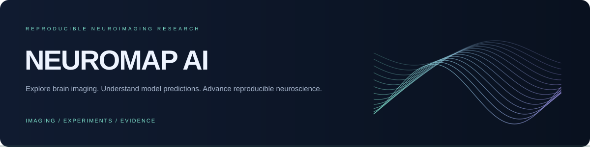
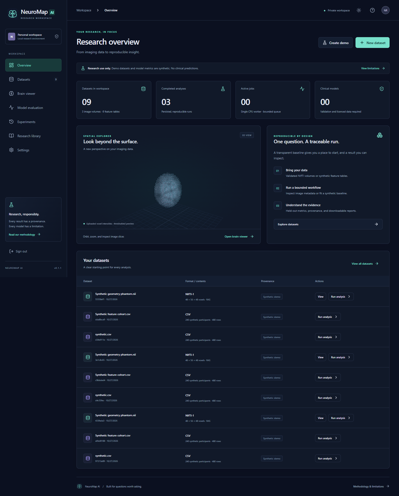
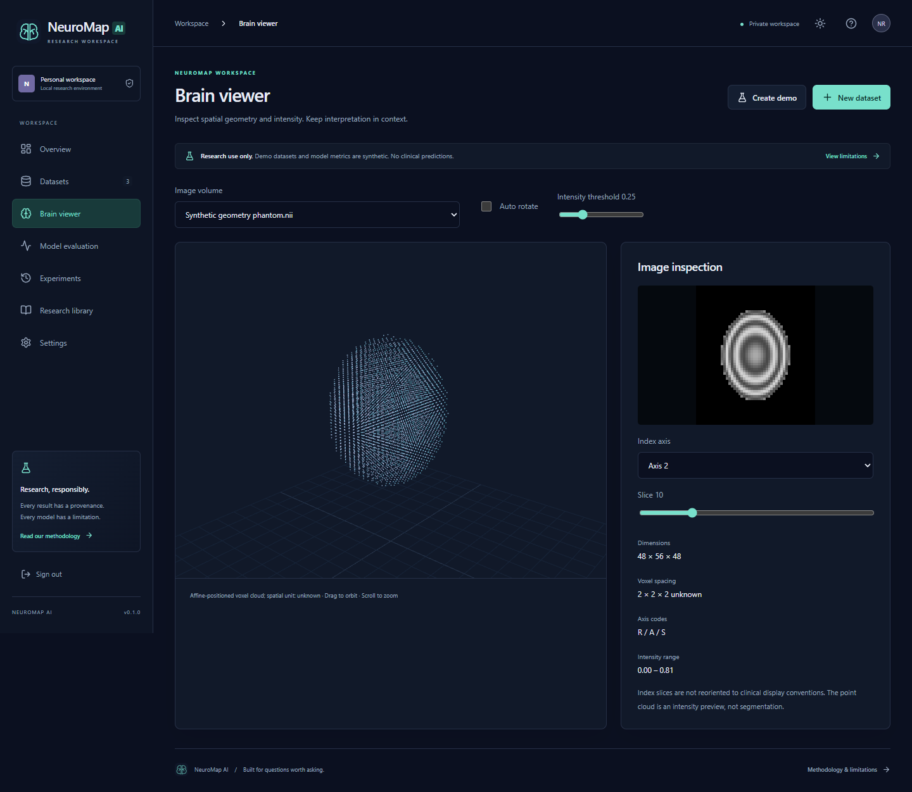
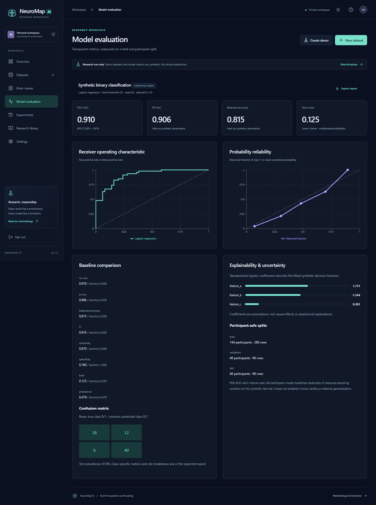
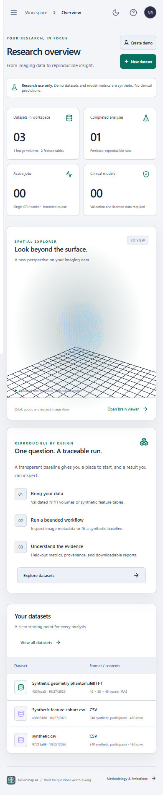
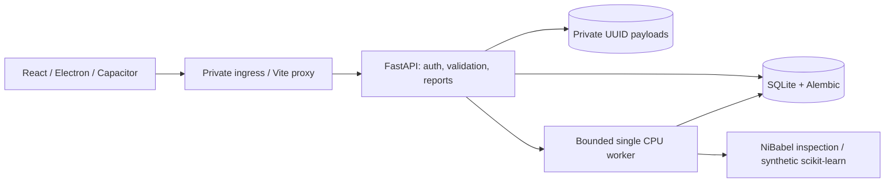
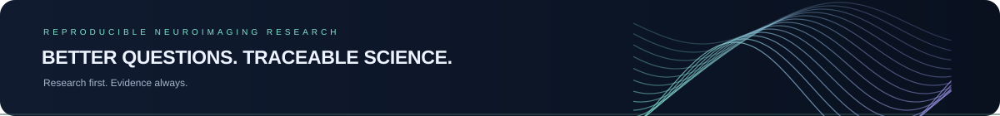

# NeuroMap AI

**Explore brain imaging. Understand model predictions. Advance reproducible neuroscience.**

[](https://github.com/manikantbindass/NeuroMap.AI/actions/workflows/ci.yml)
[](https://github.com/manikantbindass/NeuroMap.AI/releases)
[](LICENSE)

[User guide](docs/user-guide/README.md) · [Installation](docs/INSTALLATION.md) · [Research review](docs/RESEARCH_REVIEW.md) · [Verification](docs/VERIFICATION.md) · [Releases](https://github.com/manikantbindass/NeuroMap.AI/releases)

> Research and education only. No clinical model, disease diagnosis, clinical risk prediction, regulatory clearance or independent clinical validation. The classifier uses **synthetic tabular features**, not MRI-derived disease features.

## Overview

A private research workspace combining bounded image inspection, transparent machine-learning experiments and traceable results. Neuroimaging work benefits from tools that make data assumptions, partitions and limitations visible. This foundation prioritizes a working upload → analysis → report flow before advanced models.

## Goals and non-goals

Support reproducible engineering and careful exploration: NIfTI geometry, voxel/slice views, participant-safe synthetic experiments and explicit provenance. Clinical deployment, universal neurological diagnosis, segmentation, registration and automated treatment decisions are outside this release's scope.

## Current status and features

Version **0.1.0**, research foundation prerelease. See [actual quality-gate outcomes](docs/VERIFICATION.md).

- Authenticated single-owner workspace; in-memory browser sessions, logout and restart invalidation.
- Validated uploads with consent, bounded formats/resources and private server storage.
- NIfTI-1 metadata inspection, affine-positioned intensity point clouds, grayscale slices and display controls.
- Original synthetic cohort/geometry phantom generation and downloadable fixtures.
- Reproducible logistic-regression workflow, dummy comparison, participant partitions and computed evaluation.
- Persisted experiment history, bounded job queue, queued cancellation and idempotent submissions.
- JSON reports containing metrics, coefficients, checksums, partitions and versions.
- Responsive dashboard, light/dark themes, reduced-motion support and explicit empty/error states.
- Electron desktop client and genuine Capacitor Android/iOS source projects; build status is platform-specific.

## Screenshots

Real captures of the running application with **synthetic data**, not clinical records or generated mockups:



<details><summary>Image viewer, evaluation and mobile web</summary>





</details>

## Demo and downloads

Run locally and choose **Create demo**, then **Run analysis**. No hosted public demo is claimed. Download only assets listed on the [actual release page](https://github.com/manikantbindass/NeuroMap.AI/releases). Source/native project generation does not imply a successful signed binary. Consult the release manifest and [signing guide](docs/RELEASE_AND_SIGNING.md).

## Architecture



Single process, modular monolith. [Architecture, sequence and failure handling](docs/architecture/README.md). PostgreSQL, external queues and GPU models are future deployment/science decisions, not claimed implementations.

## Technology stack

React 19, TypeScript, Vite, Three.js, Recharts, Lucide; Python 3.12, FastAPI, Pydantic, SQLAlchemy/Alembic, NumPy, SciPy, scikit-learn, NiBabel; Electron; Capacitor; Docker/Compose and GitHub Actions. Exact installed versions are in committed lockfiles. No mandatory GPU runtime or model-weight download.

## Repository structure

```text
frontend/       React app, unit tests and Playwright workflow
backend/        API, migrations and API/security tests
ml/             Synthetic pipeline, configuration and scientific tests
desktop/        Sandboxed Electron server client
mobile/         Capacitor config and Android/iOS native projects
docs/           Research, architecture, API, operations and user guides
references/     Bibliography entrypoint
scripts/        Local run, load smoke, branding and artifact manifests
assets/         Original branding and actual screenshots
.github/        CI, security, native source and release workflows
releases/       Release policy and notes (generated assets ignored)
```

## Data sources and licensing

Bundled workflows generate original artificial data, licensed with the project. No ADNI, PPMI, UK Biobank, OpenNeuro cohort, trained weights or third-party anatomical mesh is bundled. Controlled datasets require approved access; check each actual release/DUA before any processing. [Catalog and access restrictions](docs/DATASET_CATALOG.md) · [dataset card](docs/research/DATASET_CARD.md).

## Research methodology

**Research reviewed through 2026-10-27.** Targeted search of official standards, publisher/PubMed records, abstracts and technical documentation; not an exhaustive systematic review. Includes BIDS, GMLP, TRIPOD+AI/CLAIM, leakage evidence, disease-specific studies and 2026 foundation-model work. See [review](docs/RESEARCH_REVIEW.md), [literature matrix](docs/LITERATURE_MATRIX.md), [model selection](docs/MODEL_SELECTION.md) and [references](references/README.md) for traceable links, inclusion method and limitations.

## Supported imaging formats

Single-file scalar **3D NIfTI-1**: `.nii` and `.nii.gz`; default 16 MiB uploaded / 64 MiB decompressed, at most 4 million voxels and 256 per axis. Metadata/geometry and intensity inspection only. DICOM, ZIP/tar, NIfTI-2, paired images and 4D acquisitions are unsupported. CSV accepts the exact documented synthetic schema. Validation is not de-identification, BIDS compliance, segmentation or diagnostic QC.

## Model methodology and comparison

Three dimensionless artificial features; generated binary label; repeated observations grouped by artificial participant. Standardization fits training only. Validation selects logistic C from 0.1/1/10; final held-out test uses threshold 0.5. Training-prior DummyClassifier comparison. No disease population is represented. [Protocol](docs/MODEL_SELECTION.md) · [model card](docs/research/MODEL_CARD.md).

## Evaluation, explainability and uncertainty

Participant-level 60/20/20 partitions, seeded training, ROC-AUC, average precision (PR-AUC), balanced accuracy, F1, sensitivity, specificity, prevalence, class metrics, confusion matrix and Brier/reliability. Participant-cluster bootstrap ROC-AUC interval (200 resamples). Site metrics are descriptive, not site-held-out validation. Standardized coefficients describe fitted associations, not causality or regional anatomy. No external clinical validation or calibrated patient risk is claimed.

## Prerequisites

Python 3.12, Node 24/npm, Git; CPU-only. Docker Linux engine optional. Native builds have separate SDK/signing requirements. Keep sufficient free memory for scientific imports, browser WebGL and native packaging. [Environment evidence](docs/PROJECT_AUDIT.md).

## Quick start with Docker

```powershell
$env:NEUROMAP_PASSWORD = Read-Host 'Choose a unique password (12+ characters)'
docker compose up --build -d
```

Open http://localhost:8080. Stop with `docker compose down`. Requires a working Linux Docker daemon; see [deployment and backup](docs/deployment/README.md).

## Quick start without Docker: backend

From repository root in PowerShell:

```powershell
py -3.12 -m venv .venv
.\.venv\Scripts\python.exe -m pip install --upgrade pip
.\.venv\Scripts\python.exe -m pip install -r backend/requirements-lock.txt
$env:NEUROMAP_PASSWORD = Read-Host 'Choose a unique password (12+ characters)'
New-Item -ItemType Directory -Force data
.\.venv\Scripts\python.exe -m alembic upgrade head
.\.venv\Scripts\python.exe -m uvicorn backend.app.main:create_app --factory --host 127.0.0.1 --port 8000 --no-access-log
```

## Frontend setup

In a second terminal:

```powershell
cd frontend
npm ci
npm run dev
```

Open http://127.0.0.1:5173 and sign in. Production: `npm run build`, then `npm run preview` on 4173 with API running. POSIX equivalents, environment table and migration guidance: [installation](docs/INSTALLATION.md).

## ML environment, training and evaluation

The backend lock includes lightweight scientific packages. No additional weights needed.

```powershell
.\.venv\Scripts\python.exe -m ml.pipeline generate --output data/synthetic.csv
.\.venv\Scripts\python.exe -m ml.pipeline train --input data/synthetic.csv --output data/experiment.json
.\.venv\Scripts\python.exe -m ml.pipeline evaluate --input data/experiment.json --output data/evaluation.json
```

`evaluate` validates the saved artifact checksum and exports recorded test metrics; it is not an independent clinical evaluation. [ML guide and onboarding](docs/ML_GUIDE.md).

## Tests and quality gates

```powershell
.\.venv\Scripts\python.exe -m ruff check .
.\.venv\Scripts\python.exe -m ruff format --check .
.\.venv\Scripts\python.exe -m pytest -q
cd frontend
npm run lint
npm test
npm run build
# With API/frontend running and NEUROMAP_PASSWORD set in this shell:
npx playwright install chromium
npm run test:e2e
```

API/migration, authentication, malformed upload, ML known-answer/split/reproducibility, browser/report and limited accessibility/responsive checks are included. [Passed/failed/blocked evidence](docs/VERIFICATION.md) distinguishes actual executions from configured CI.

## API and environment configuration

[API reference](docs/api/README.md), runtime [Swagger](http://127.0.0.1:8000/docs), [OpenAPI](http://127.0.0.1:8000/openapi.json). Runtime links require your local service. Use `.env.example` placeholders; set a unique password, private storage path and exact origins. VITE_API_URL is build-time configuration. No working credential belongs in Git. [Full configuration table](docs/INSTALLATION.md#configuration).

## Security, privacy and governance

One owner role, scrypt credential verification, hashed expiring sessions, bounded upload/decompression/voxel parsing, private UUID files, no-store responses, exact CORS, process-local rate limits, audit IDs, explicit deletion and no pickle loading. Manual retention; no automatic de-identification or tenant isolation. [Threat model](docs/SECURITY_AND_PRIVACY.md) · [security reporting](SECURITY.md) · [limitations](docs/SAFETY_AND_LIMITATIONS.md).

## Deployment and operations

Private loopback development or reviewed private TLS deployment. One API process; do not add replicas without externalizing queue/limits/storage. Stop and back up DB + payloads consistently, encrypt backups, test restores and retain version metadata. [Deployment, capacity, migration rollback and recovery](docs/deployment/README.md).

## Windows installation

Use an actual published x64 installer only if listed in the release manifest. Start frontend preview/API or configure NEUROMAP_DESKTOP_URL to a trusted HTTPS deployment. The client needs the server and contains no offline Python/ML runtime. Unsigned builds have no verified publisher signature. Source build: `cd desktop; npm ci; npm run dist`. [Build/signing details](docs/RELEASE_AND_SIGNING.md).

## Android installation

Native source is under mobile/android. No signed installable APK is implied. Configure HTTPS API, build web, sync Capacitor, use compatible JDK/Android SDK, create a release candidate and sign/verify with a private keystore before distribution. Debug and unsigned release outputs must remain clearly labeled. [Exact requirements](docs/RELEASE_AND_SIGNING.md#android).

## iOS signing limitations

Native source is under mobile/ios; macOS/Xcode and Apple signing/provisioning are required for a device archive/export. Simulator compilation does not make an IPA. No signed IPA or App Store distribution is claimed without real successful signing. [Procedure and prerequisites](docs/RELEASE_AND_SIGNING.md#ios).

## Releases and checksums

[GitHub Releases](https://github.com/manikantbindass/NeuroMap.AI/releases) host only actual produced artifacts. Compare downloaded SHA-256 to SHA256SUMS.txt and byte size/version to release-manifest.json. Automated release builds gate publication on CI and produce web/source/Windows outputs on suitable runners. Mobile source validation is separate; signing remains an owner-supplied prerequisite. [Artifact policy](releases/README.md).

## Troubleshooting and FAQ

Missing tables → apply migrations; expired session → sign in; unsupported upload → read format/limits; Docker named-pipe failure → start Linux engine; unavailable desktop backend → start/configure server. A high synthetic score does not imply disease detection. [Full troubleshooting/FAQ](docs/TROUBLESHOOTING.md).

## Roadmap

Harden worker isolation, durable dispatch and institutional operations; validate signed clients; onboard an approved cohort and frozen endpoint before any disease-specific model. Add advanced methods only with appropriate data and independent evaluation. [Gated roadmap](docs/ROADMAP.md).

## Contributing, citation and acknowledgments

[Contributing](CONTRIBUTING.md) · [conduct](CODE_OF_CONDUCT.md) · [CITATION.cff](CITATION.cff) · [bibliography](references/README.md). Cite underlying methods and any separately authorized datasets in your research. Project source is [MIT](LICENSE); dependencies and external scientific resources retain their own licenses. [Third-party notices](docs/THIRD_PARTY_NOTICES.md).

## Disclaimer, contact and issue reporting

This application is not clinically validated and is not intended for patient decisions. No clinical-model accuracy, regulatory compliance or production scalability is asserted. [Known limits](docs/SAFETY_AND_LIMITATIONS.md). Report software issues with synthetic reproductions through [GitHub Issues](https://github.com/manikantbindass/NeuroMap.AI/issues); use private channels for vulnerabilities and never attach sensitive data.


