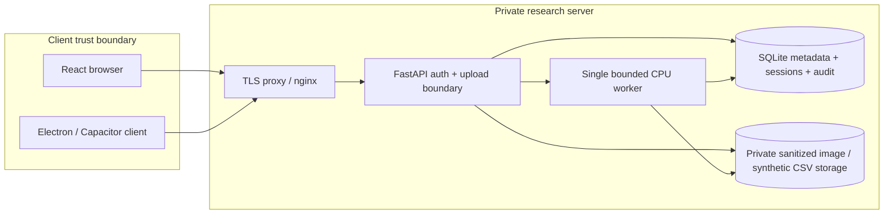
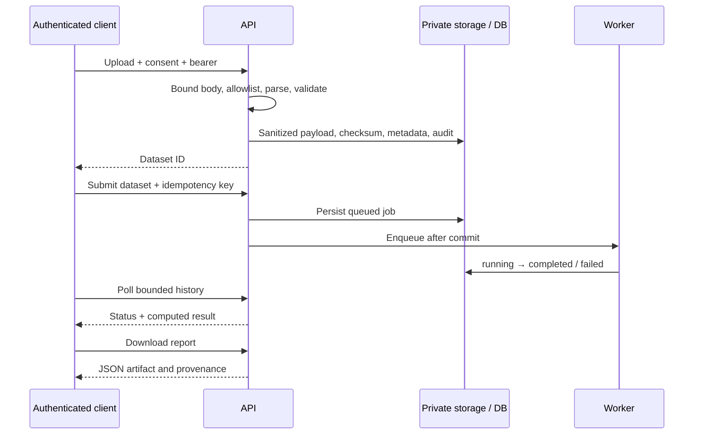

# Architecture and decision record

## Scope: modular monolith, one private workspace

React/TypeScript + Vite, Three.js, Recharts; FastAPI + Pydantic; SQLAlchemy + Alembic; SQLite; NumPy/NiBabel/scikit-learn. CPU-only. ThreadPoolExecutor with one worker and at most four outstanding jobs. SQLite jobs/report JSON act as the initial experiment/model registry. No GPU libraries, Redis, PostgreSQL driver or heavy encoder are needed for the implemented task. PostgreSQL/distributed workers remain a documented migration path, not tested features.

## Failure handling

Authentication, invalid files, consent, limits and conflicting operations return bounded errors. Idempotent retries return the existing job when the dataset matches. Queue saturation returns 429. Only queued jobs can be cancelled. Startup marks interrupted jobs failed; there is no hidden retry/retraining. Graceful shutdown drains running work. Delete is blocked while associated jobs are active. File writes preceding DB insertion are removed if insertion fails. A crash during file/DB operations may leave orphan payloads; compare stored UUID files with the dataset table during maintenance, after backups and with the API stopped.

## Decision: avoid premature distributed infrastructure

Single process (`uvicorn` without multiple workers) is mandatory: queue, rate limiter and resource locks are process-local. This trades horizontal scaling and job survival for a transparent local installation. A production migration would add external queue leases, transactionally durable dispatch, per-tenant authorization, object-store lifecycle rules, PostgreSQL migrations and distributed admission control. Validate this as a new deployment architecture before claiming scalability.
